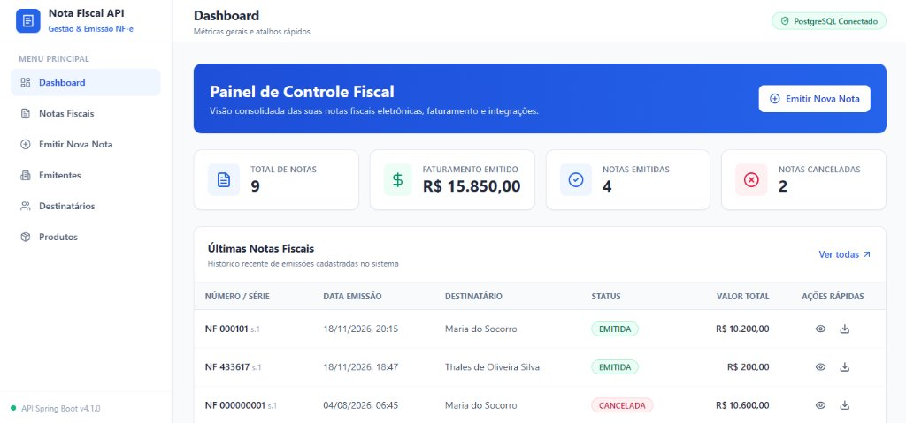
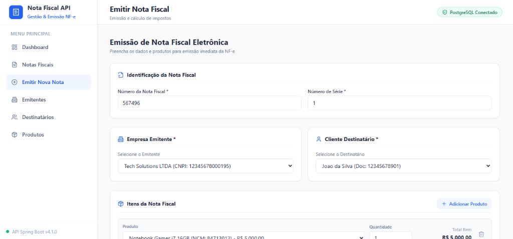
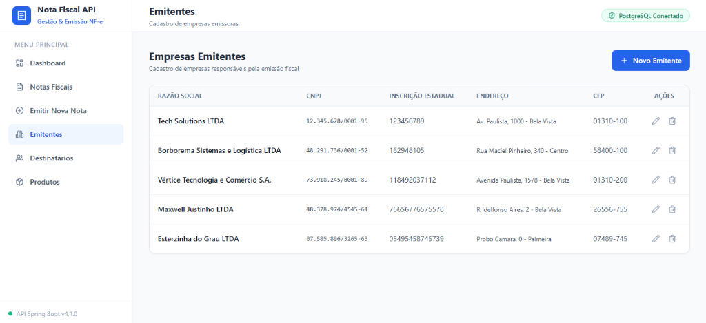
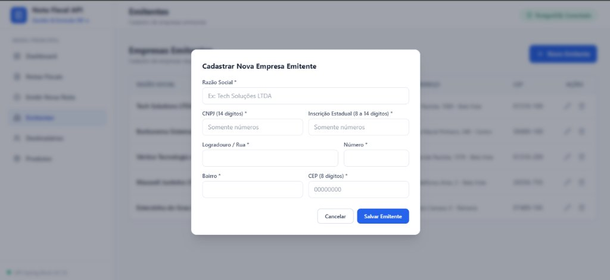
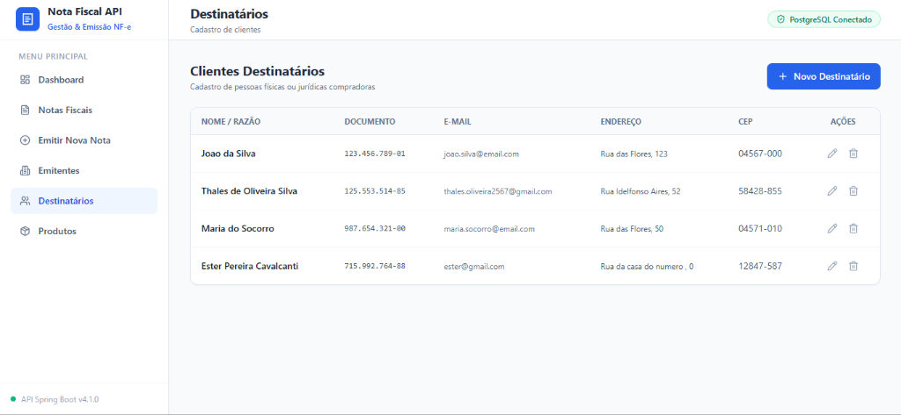
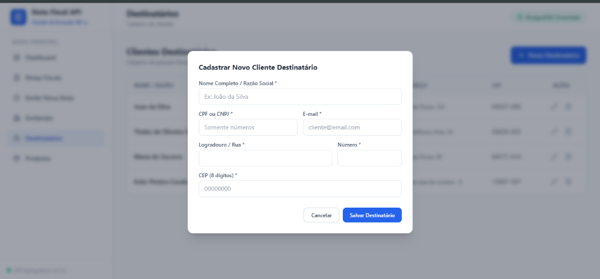
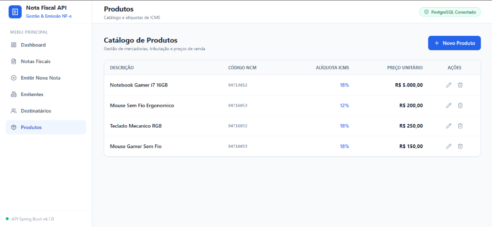
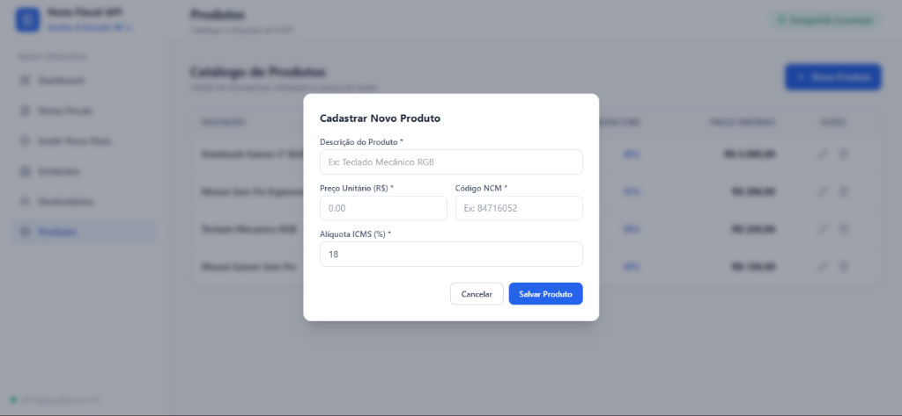

# 📜 Nota Fiscal API — Gestão, Faturamento & Integração SEFAZ

<p align="center">
  
  
  
  
  
  
  
</p>

---

## 📌 Sumário
- [Sobre o Projeto](#-sobre-o-projeto)
- [📸 Demonstração da Interface (Screenshots)](#--demonstração-da-interface-screenshots)
- [🚀 Principais Funcionalidades](#-principais-funcionalidades)
- [🛠️ Tecnologias Utilizadas](#️-tecnologias-utilizadas)
- [⚖️ Regras de Negócio & Fiscais](#️-regras-de-negócio--fiscais)
- [💻 Como Executar o Projeto](#-como-executar-o-projeto)
- [📡 Endpoints da API](#-endpoints-da-api)
- [🧪 Massa de Dados para Testes](#-massa-de-dados-para-testes)
- [👨‍💻 Autor](#-autor)

---

## 📝 Sobre o Projeto

O **`nota-fiscal-api`** é um sistema web full-stack corporativo para faturamento, gestão e auditoria de **Notas Fiscais Eletrônicas (NF-e Modelo 55)**. 

O projeto foi construído para simular o ciclo de vida real de um faturamento fiscal brasileiro:
1. **Cadastros de Apoio:** Gestão de Emitentes, Clientes (PF e PJ) e Produtos com tributação individualizada e travas de imutabilidade.
2. **Cálculo Tributário Automático:** Apuração em tempo real de **ICMS** com precisão monetária via `BigDecimal`.
3. **Geração Oficial de NF-e:** Montagem do arquivo **XML (Layout SEFAZ 4.00)** e cálculo da **Chave de Acesso de 44 dígitos**.
4. **Comunicação Real com a SEFAZ:** Disparo síncrono via **SOAP 1.2** sobre TLS com as raízes oficiais da **ICP-Brasil** para o webservice da **SVRS (Ambiente de Homologação)**, capturando latência de rede em milissegundos e cabeçalhos de auditoria.
5. **Emissão de DANFE (PDF):** Geração programática do documento auxiliar com OpenPDF contendo marca d'água dinâmica de conformidade fiscal.
6. **Cancelamento Seguro:** Fluxo de anulação via `PATCH` preservando a rastreabilidade e imutabilidade dos registros contábeis.

---

## 📸  Demonstração da Interface (Screenshots)

### 📊 1. Dashboard e Visão Geral

*Painel de controle com KPIs de faturamento emitido, total de notas cadastradas, notas emitidas e canceladas, com listagem recente.*

---

### 📝 2. Emissão de Nota Fiscal

*Formulário de faturamento com seleção de emitente, destinatário, adição de múltiplos produtos e cálculo dinâmico de ICMS.*

---

### 🏢 3. Empresas Emitentes
| Listagem de Emitentes | Modal de Cadastro |
|:---:|:---:|
|  |  |
| *Listagem com CNPJ, IE e Endereço* | *Formulário de cadastro com validações* |

---

### 👥 4. Clientes Destinatários
| Listagem de Destinatários | Modal de Cadastro |
|:---:|:---:|
|  |  |
| *Identificação de Pessoa Física e Jurídica* | *Validação de formato de CPF (11) e CNPJ (14)* |

---

### 📦 5. Catálogo de Produtos
| Listagem de Produtos | Modal de Cadastro |
|:---:|:---:|
|  |  |
| *Tabela com NCM, Alíquota ICMS e Preço Unitário* | *Definição de classificação fiscal e preço* |

---

### 🏛️ 6. Auditoria SEFAZ & DANFE (PDF)
> *Para conferir os logs em tempo real da SEFAZ e o DANFE gerado:*
* **Transmissão SEFAZ:** Exibe modal com tempo de resposta em ms, código HTTP do servidor e envelope SOAP completo.
* **DANFE impresso:** Arquivo PDF com chave de acesso de 44 dígitos e marca d'água oficial "SEM VALOR FISCAL / NÃO AUTORIZADA PELA SEFAZ".

---

## 🚀 Principais Funcionalidades

- [x] **Arquitetura em Camadas:** Controller, Service, Repository, DTO e Mapper bem delimitados.
- [x] **Cálculos Fiscais Precisos:** Multiplicação e rateio de alíquotas com `BigDecimal` e `RoundingMode.HALF_UP`.
- [x] **Chave de Acesso de 44 Dígitos:** Composição com código da UF, ano/mês, CNPJ, modelo, série e número.
- [x] **XML Layout 4.00:** Estrutura completa com nós `<ide>`, `<emit>`, `<dest>`, `<det>`, `<prod>`, `<imposto>` e `<ICMSTot>`.
- [x] **Cliente SOAP 1.2 Nativo:** `SefazClient` sem bibliotecas pesadas de terceiros, usando `java.net.http.HttpClient`.
- [x] **Segurança TLS sem Gambiarras:** Certificados públicos raiz da **ICP-Brasil** injetados no TrustStore (sem "trust-all").
- [x] **Suporte a Certificado Digital A1:** Leitura de arquivo `.pfx` via PKCS12 para autenticação mútua (mTLS).
- [x] **Fuso Horário Sincronizado:** Padrão oficial de Brasília (`America/Sao_Paulo` / `-03:00`).
- [x] **Tratamento Centralizado de Exceções:** `@RestControllerAdvice` capturando erros de Bean Validation e integridade.
- [x] **Docker Compose 100% Configurado:** Sobe banco PostgreSQL, pgAdmin, backend Spring Boot e frontend React em 1 comando.

---

## 🛠️ Tecnologias Utilizadas

### Backend
* **Java 21 LTS**
* **Spring Boot 4.1.0**
  * Spring Data JPA
  * Spring WebMVC
  * Jakarta Bean Validation (`hibernate-validator`)
* **OpenPDF (1.3.30)** — Geração programática de DANFE
* **Jakarta XML Binding (JAXB)** — Manipulação e parsing XML
* **Lombok** — Redução de código boilerplate

### Frontend
* **React 18**
* **TypeScript**
* **Vite** — Build tool ultra-rápido
* **Tailwind CSS** — Estilização moderna e responsiva
* **Axios** — Cliente HTTP
* **Lucide React** — Ícones

### Banco de Dados & DevOps
* **PostgreSQL 16**
* **pgAdmin 4**
* **Docker & Docker Compose**
* **Nginx** — Servidor web estático no container do frontend

---

## ⚖️ Regras de Negócio & Fiscais

1. **Imutabilidade Fiscal da Nota:** Notas fiscais emitidas não sofrem `UPDATE` nem `DELETE`. O único fluxo legal permitido é o cancelamento (`PATCH /api/notas-fiscais/{id}/cancelar`).
2. **Condição de Cancelamento:** Somente notas que foram previamente autorizadas (`EMITIDA`) podem ser canceladas. Notas com status `REJEITADA` ou `CANCELADA` rejeitam nova anulação.
3. **Travas Cadastrais (CNPJ/CPF):** Na edição de emitentes e destinatários, o documento de identificação é somente leitura (`disabled`), pois representa a identidade fiscal unívoca do contribuinte.
4. **Proteção de Integridade Referencial:** Empresas ou produtos associados a notas fiscais existentes não podem ser excluídos (retorno `HTTP 409 Conflict`).
5. **Classificação por NCM:** Todo produto carrega obrigatoriamente seu código NCM de 8 dígitos para correta apuração do ICMS.

---

## 💻 Como Executar o Projeto

### Pré-requisitos
* Ter o **Docker Desktop** instalado e em execução na máquina.

### Executando em 1 Passo:

1. Clone o repositório:
```bash
git clone https://github.com/ThalesOS/nota-fiscal-api.git
cd nota-fiscal-api
```

2. Inicialize todos os containers:
```bash
docker compose up -d --build
```

### URLs de Acesso:

| Aplicação | Endereço | Descrição |
|---|---|---|
| **Frontend Web** | [http://localhost:3000](http://localhost:3000) | Interface do Sistema |
| **Backend API** | [http://localhost:8081](http://localhost:8081) | Endpoints REST |
| **pgAdmin 4** | [http://localhost:8080](http://localhost:8080) | Painel Web do PostgreSQL |

> **Acesso ao pgAdmin:**  
> * **E-mail:** `admin@admin.com` | **Senha:** `root`  
> * **Host no registro do Server:** `postgres-db` | **Port:** `5432` | **User/Pass:** `root` / `root`

---

## 📡 Endpoints da API

### 📄 Notas Fiscais (`/api/notas-fiscais`)
| Método | Endpoint | Descrição |
|:---:|---|---|
| `POST` | `/api/notas-fiscais` | Emite nota fiscal, calcula impostos e transmite à SEFAZ |
| `GET` | `/api/notas-fiscais` | Lista todas as notas com dados de auditoria SEFAZ |
| `GET` | `/api/notas-fiscais/{id}` | Busca os detalhes de uma nota fiscal por ID |
| `PATCH` | `/api/notas-fiscais/{id}/cancelar` | Cancela uma nota autorizada (aceita também PUT e POST) |
| `GET` | `/api/notas-fiscais/{id}/xml` | Download do arquivo XML oficial (Layout 4.00) |
| `GET` | `/api/notas-fiscais/{id}/pdf` | Download do DANFE impresso em formato PDF |

### 🏢 Emitentes (`/api/emitentes`)
* `GET /api/emitentes` — Lista emitentes
* `POST /api/emitentes` — Cadastra novo emitente
* `PUT /api/emitentes/{id}` — Atualiza emitente (CNPJ travado)
* `DELETE /api/emitentes/{id}` — Remove emitente (bloqueado se houver notas)

### 👥 Destinatários (`/api/destinatarios`)
* `GET /api/destinatarios` — Lista clientes
* `POST /api/destinatarios` — Cadastra novo cliente (PF/PJ)
* `PUT /api/destinatarios/{id}` — Atualiza cliente (CPF/CNPJ travado)
* `DELETE /api/destinatarios/{id}` — Remove cliente (bloqueado se houver notas)

### 📦 Produtos (`/api/produtos`)
* `GET /api/produtos` — Lista produtos
* `POST /api/produtos` — Cadastra produto com NCM e alíquota de ICMS
* `PUT /api/produtos/{id}` — Atualiza dados do produto
* `DELETE /api/produtos/{id}` — Remove produto (bloqueado se houver notas)

---

## 🧪 Massa de Dados para Testes

Para testar o faturamento com dados sintéticos válidos perante a SEFAZ:

* **Emitente Exemplo:** `TechPrime Soluções LTDA` | CNPJ: `45.892.104/0001-90` | IE: `110.245.890.115`
* **Destinatário PF:** `Lucas Gabriel Ferreira` | CPF: `045.892.130-74`
* **Destinatário PJ:** `Inova Consultoria LTDA` | CNPJ: `33.568.120/0001-15`
* **Produtos:**
  * Notebook Dell Latitude i7 (NCM `84713012` | ICMS `18%` | R$ 4.850,00)
  * Monitor UltraWide LG 29 Pol (NCM `85285200` | ICMS `18%` | R$ 1.150,00)
  * Teclado Mecânico Logitech (NCM `84716052` | ICMS `12%` | R$ 580,00)
  * Mouse Sem Fio Vertical (NCM `84716053` | ICMS `12%` | R$ 220,00)
  * Cabo HDMI 2.1 Ultra High Speed (NCM `85444200` | ICMS `7%` | R$ 65,00)

---

## 👨‍💻 Autor

Desenvolvido por **Thales Oliveira**  
* GitHub: [@ThalesOS](https://github.com/ThalesOS)
* LinkedIn: [Thales Oliveira](https://www.linkedin.com/in/thales-oliveira-silva/)
